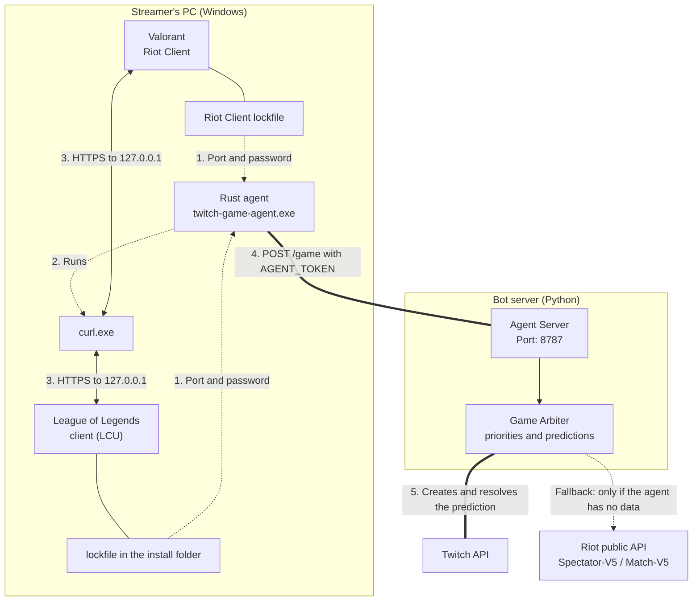
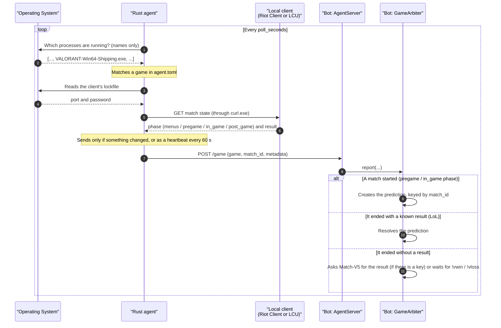

# Architecture and Flow: Match Detection

This document describes how the agent detects Valorant and League of Legends matches on the streamer's PC, and how the bot uses them to create and resolve predictions.

The general rule: **local client first, public APIs second.** The agent reads the match state straight from the game client, with no API key. If the agent has no data, the bot falls back to the public APIs (Riot for LoL).

## Network Architecture Diagram

The agent runs on the streamer's PC and the bot on another machine. They talk over the local network or a VPN such as Tailscale.



HTTPS calls are delegated to `curl.exe`, which ships with Windows 10/11. That way the agent needs no TLS stack of its own and builds with the GNU toolchain without a C compiler.

---

## What the agent queries for each game

### Valorant: Riot Client local presence

| Endpoint (127.0.0.1) | Purpose |
|---|---|
| `GET /chat/v1/session` | PUUID of the signed-in account (`puuid` field) |
| `GET /chat/v4/presences` | Our own presence carries `private`, a base64 JSON with the session state |

Inside `private`, the `sessionLoopState` field is `MENUS`, `PREGAME` (agent select) or `INGAME`. The agent looks for it both in the flat format and in the grouped one (`matchPresenceData`), because Riot changed the structure.

The presence carries no match ID. The agent creates its own key (`val-<timestamp>`) when she leaves the menus and releases it when she goes back. That is enough to keep the bot from creating two predictions for the same match.

> [!IMPORTANT]
> `/core-game` and `/pregame` are **not** local client endpoints: they live on Riot's remote servers (`glz-{region}-1.{shard}.a.pvp.net`) and need a different authentication. Asking `127.0.0.1` for them always returns 404. That is why Valorant never created predictions automatically.

### League of Legends: local client (LCU)

| Endpoint (127.0.0.1) | Purpose |
|---|---|
| `GET /lol-gameflow/v1/gameflow-phase` | Which screen it is on: lobby, champ select, match, end |
| `GET /lol-gameflow/v1/session` | The match's `gameData.gameId` |
| `GET /lol-end-of-game/v1/eog-stats-block` | Who won, when it ends |

The `gameId` is the same number Match-V5 uses: if the agent misses the end-of-game screen, the bot can confirm the result through the public API with the same key.

The prediction only opens when the match starts, not in champion select: a dodge does not leave a prediction hanging.

---

## Sequence Diagram (Logical Flow)

Every `poll_seconds` (5 by default):



The arbiter reacts to **any** change in the match: that it starts, that it ends, or that the result arrives. It used to react only to a new `match_id`, so the end of a match went unnoticed.

## JSON Payload Summary

Valorant, mid-match:

```json
{
  "source": "agent",
  "game": "VALORANT",
  "exe": "VALORANT-Win64-Shipping.exe",
  "match_id": "val-1761867240000",
  "metadata": {
    "source": "presence",
    "phase": "in_game",
    "queue": "competitive",
    "score": { "ally": 7, "enemy": 4 }
  },
  "host": "DESKTOP-STREAMER",
  "agent_version": "0.1.0",
  "sent_at": "2026-10-30T23:34:00Z"
}
```

League of Legends, on the end-of-game screen:

```json
{
  "game": "League of Legends",
  "exe": "League of Legends.exe",
  "match_id": "1570331942",
  "metadata": {
    "source": "lcu",
    "phase": "post_game",
    "client_phase": "EndOfGame",
    "queue_id": 420,
    "result": "win"
  }
}
```

Back in the lobby, `match_id` becomes `null` and the finished match moves to `metadata.last_match` (`{"id": ..., "result": "win"}` in LoL, `{"id": ..., "score": {...}}` in Valorant). That way the bot can resolve it even if it missed the end-of-game screen.

> [!TIP]
> To see what the agent is reading at a given moment, run `twitch-game-agent.exe --once` with the game open: it shows the phase, the match and any problem with the local API.

## Resolving predictions

| Game | Created | Resolved |
|---|---|---|
| League of Legends | When the match starts, with the local `gameId`. Fallback: Spectator-V5 | With the local client's result. Fallback: Match-V5. Last resort: `!vwin` / `!vloss` |
| Valorant | On entering agent select, with the agent's key | Manually with `!vwin` / `!vloss`. The agent already reports the final score, so automating it is a small change |

Prediction titles and options ("¿Gana esta partida?", "Gana", "Pierde") stay in Spanish: they are what viewers see.
