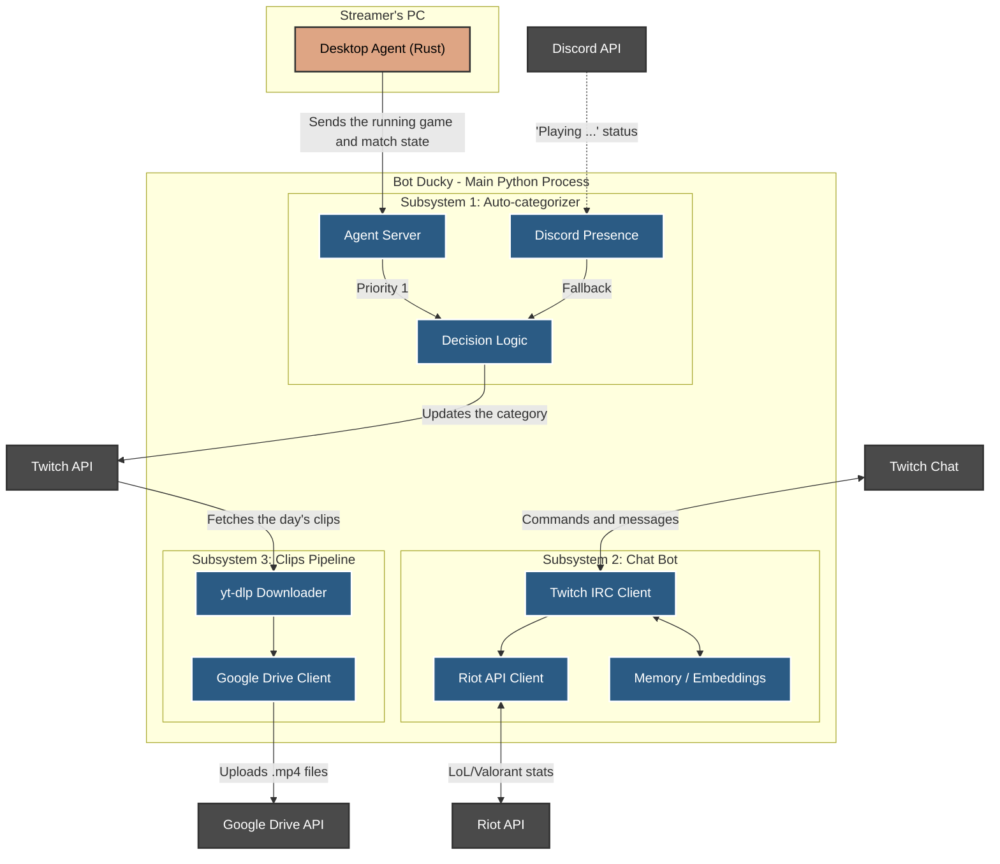

# System Architecture

This diagram shows the project's three main subsystems and how they interact with external services (Twitch, Discord, Riot, Google Drive and the desktop agent), all running inside the same Python process.

For how the agent reads each game's match state, see [`agent.md`](agent.md). For the chat embeddings flow, see [`embeddings.md`](embeddings.md).
