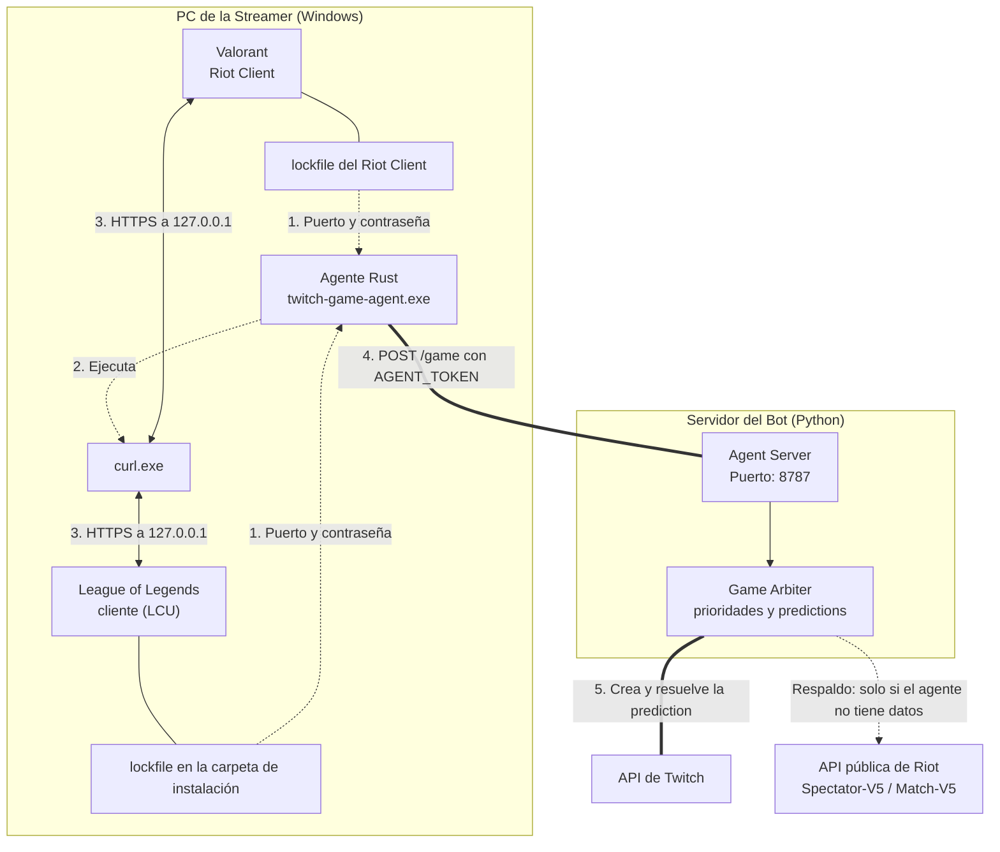
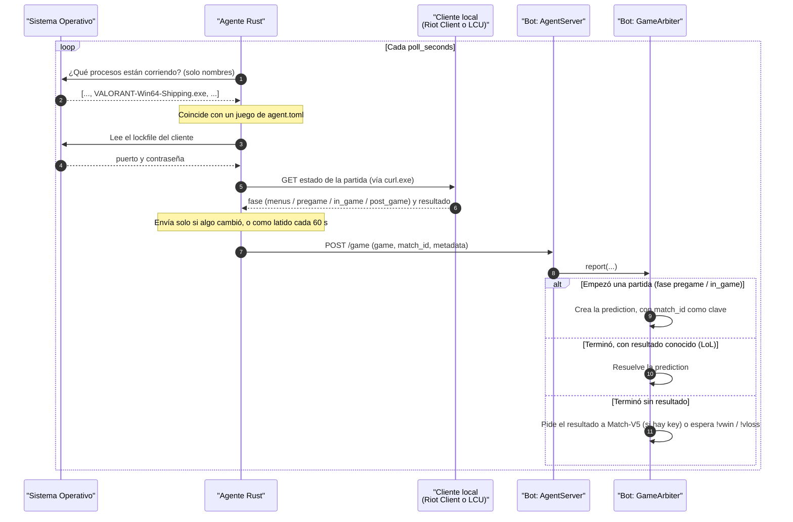

# Arquitectura y Flujo: Detección de partidas

Este documento describe cómo el agente detecta partidas de Valorant y League of Legends en la PC de la streamer y cómo el bot las usa para crear y resolver predictions.

La regla general: **primero el cliente local, después las APIs públicas.** El agente lee el estado de la partida directo del cliente del juego, sin ninguna API key. Si el agente no tiene datos, el bot recurre a las APIs públicas (Riot para LoL) como respaldo.

## Diagrama de Arquitectura de Red

El agente corre en la PC de la streamer y el bot en otra máquina. Se comunican por la red local o por una VPN como Tailscale.



Las llamadas HTTPS se delegan a `curl.exe`, que viene con Windows 10/11. Así el agente no necesita una pila TLS propia y se compila con el toolchain GNU sin compilador de C.

---

## Qué consulta el agente en cada juego

### Valorant: presencia local del Riot Client

| Endpoint (127.0.0.1) | Para qué |
|---|---|
| `GET /chat/v1/session` | PUUID de la cuenta logueada (campo `puuid`) |
| `GET /chat/v4/presences` | La presencia propia trae `private`, un JSON en base64 con el estado de la sesión |

Dentro de `private`, el campo `sessionLoopState` vale `MENUS`, `PREGAME` (selección de agentes) o `INGAME`. El agente lo busca en el formato plano y en el agrupado (`matchPresenceData`), porque Riot cambió la estructura.

La presencia no trae un ID de partida. El agente crea una clave propia (`val-<timestamp>`) cuando ella sale de los menús y la suelta cuando vuelve. Alcanza para que el bot no cree dos predictions para la misma partida.

> [!IMPORTANT]
> `/core-game` y `/pregame` **no** son endpoints del cliente local: viven en los servidores remotos de Riot (`glz-{region}-1.{shard}.a.pvp.net`) y piden otra autenticación. Pedirlos a `127.0.0.1` devuelve 404 siempre. Esa fue la causa de que Valorant nunca creara predictions automáticamente.

### League of Legends: cliente local (LCU)

| Endpoint (127.0.0.1) | Para qué |
|---|---|
| `GET /lol-gameflow/v1/gameflow-phase` | En qué pantalla está: lobby, selección, partida, fin |
| `GET /lol-gameflow/v1/session` | `gameData.gameId` de la partida |
| `GET /lol-end-of-game/v1/eog-stats-block` | Quién ganó, al terminar |

El `gameId` es el mismo número que usa Match-V5: si el agente se pierde la pantalla de fin, el bot puede confirmar el resultado por la API pública con la misma clave.

La prediction se abre recién cuando arranca la partida, no en selección de campeones: un dodge no deja una prediction colgada.

---

## Diagrama de Secuencia (Flujo Lógico)

Cada `poll_seconds` (5 por defecto):



El arbiter reacciona a **cualquier** cambio de la partida: que empiece, que termine o que llegue el resultado. Antes solo reaccionaba a un `match_id` nuevo, así que el fin de una partida pasaba desapercibido.

## Resumen del Payload JSON

Valorant, en plena partida:

```json
{
  "source": "agent",
  "game": "VALORANT",
  "exe": "VALORANT-Win64-Shipping.exe",
  "match_id": "val-1761867240000",
  "metadata": {
    "source": "presence",
    "phase": "in_game",
    "queue": "competitive",
    "score": { "ally": 7, "enemy": 4 }
  },
  "host": "DESKTOP-STREAMER",
  "agent_version": "0.1.0",
  "sent_at": "2026-10-30T23:34:00Z"
}
```

League of Legends, en la pantalla de fin:

```json
{
  "game": "League of Legends",
  "exe": "League of Legends.exe",
  "match_id": "1570331942",
  "metadata": {
    "source": "lcu",
    "phase": "post_game",
    "client_phase": "EndOfGame",
    "queue_id": 420,
    "result": "win"
  }
}
```

De vuelta en el lobby, el `match_id` pasa a `null` y la partida terminada queda en `metadata.last_match` (`{"id": ..., "result": "win"}` en LoL, `{"id": ..., "score": {...}}` en Valorant). Así el bot puede resolver aunque se haya perdido la pantalla de fin.

> [!TIP]
> Para ver qué está leyendo el agente en un momento dado, corré `twitch-game-agent.exe --once` con el juego abierto: muestra la fase, la partida y cualquier problema con la API local.

## Resolución de las predictions

| Juego | Se crea | Se resuelve |
|---|---|---|
| League of Legends | Al arrancar la partida, con el `gameId` local. Respaldo: Spectator-V5 | Con el resultado del cliente local. Respaldo: Match-V5. Último recurso: `!vwin` / `!vloss` |
| Valorant | Al entrar a selección de agentes, con la clave del agente | Manual con `!vwin` / `!vloss`. El agente ya reporta el score final, así que automatizarlo es un cambio chico |
