# Chat Embeddings Flow

How chat messages are stored, embedded in the background and searched semantically.

Steps 1 and 2 run today. Step 3 is available as `EmbeddingWorker.search`, but no
chat command calls it yet: `!resumen` samples the stored messages instead.

```mermaid
sequenceDiagram
    participant T as Twitch (Chat)
    participant B as Bot (chat_history_db.py)
    participant Q as Async Queue
    participant W as EmbeddingWorker
    participant API as Embeddings API (Gemini / OpenAI)
    participant DB as PostgreSQL (pgvector)

    %% Storing flow
    rect rgb(30, 30, 30)
    Note over T,DB: 1. Storing messages
    T->>B: New chat message
    B->>DB: Stores the message (INSERT INTO chat_messages)
    DB-->>B: Returns `message_id`
    B->>Q: Queues (message_id, text)
    end

    %% Worker flow (background)
    rect rgb(20, 40, 60)
    Note over Q,DB: 2. Background processing (batches)
    W->>Q: Takes up to EMBEDDING_BATCH_SIZE messages
    W->>API: POST /embeddings (OpenAI format)
    Note right of W: Uses the model set<br/>in EMBEDDING_MODEL
    API-->>W: Returns vectors (Float[])
    W->>DB: Stores the vectors (INSERT INTO chat_embeddings)
    end

    %% Semantic search flow
    rect rgb(60, 30, 60)
    Note over T,DB: 3. Semantic search (EmbeddingWorker.search, not wired to a command yet)
    T->>B: Summary / search command
    B->>API: POST /embeddings (text to search)
    API-->>B: Returns the query vector
    B->>DB: Similarity search (pgvector <=>)
    DB-->>B: Returns the most similar messages
    B-->>T: Replies to the user
    end
```

