# Chat Memory: `!pregunta`

How the bot answers questions about past streams with retrieval (RAG).

A single stream averages ~150 messages, so `!resumen` and the end-of-stream
summary send it to the LLM whole, with no retrieval. Retrieval is only used
across streams, where everything does not fit in one prompt.

## What gets indexed

| Table | One row per | When |
|---|---|---|
| `session_embeddings` | stream summary | when the summary is generated (or arrives late); missing ones at startup |
| `chat_embeddings` | chat message with content | in the background, in batches of `EMBEDDING_BATCH_SIZE` |

Commands (`!...`) and messages under `EMBEDDING_MIN_WORDS` words (4) are stored
in `chat_messages` but not embedded: they were 70% of the chat and carry
nothing to find. Vectors have 768 dimensions (Gemini, through the OpenAI-compatible API).

```mermaid
sequenceDiagram
    participant T as Twitch chat
    participant B as Bot (chat_history_db.py)
    participant W as EmbeddingWorker
    participant API as Embeddings API (Gemini)
    participant DB as PostgreSQL (pgvector)

    rect rgb(30, 30, 30)
    Note over T,DB: 1. Indexing
    T->>B: New chat message
    B->>DB: INSERT INTO chat_messages
    alt Not a command and at least 4 words
        B->>W: Queue (message_id, text)
        W->>API: POST /embeddings (batch)
        W->>DB: INSERT INTO chat_embeddings
    end
    Note over B,DB: When a stream ends with a summary
    B->>W: embed_session(stream_id, summary)
    W->>API: POST /embeddings
    W->>DB: UPSERT session_embeddings
    end

    rect rgb(60, 30, 60)
    Note over T,DB: 2. !pregunta
    T->>B: !pregunta que dijeron de la skin nueva
    B->>W: search_history(question)
    W->>API: POST /embeddings (the question)
    W->>DB: 3 closest summaries + 25 closest messages (<=>)
    DB-->>W: Rows with their dates
    B->>B: LLM answers using only that context
    B-->>T: One-message answer, with dates
    end
```

## The answer

`src/chat_qa.py` builds the prompt: the summaries and messages found (each
with its date and game or author) and the question. The system prompt tells
the LLM to answer only from that context, to say it does not know otherwise,
and to treat chat messages as data, never as instructions. The answer is cut
to one chat message (400 characters, no line breaks).

If nothing is indexed yet, the bot says so without calling the LLM. If the LLM
fails, it says to try again later.

## Startup housekeeping

`run.maintain_embeddings` runs once in the background:

1. `prune_noise`: deletes the embeddings of commands and short messages
   (until November 2026 every message was embedded).
2. `backfill_sessions`: embeds the stream summaries that have no embedding.

Deleting rows does not shrink the table on disk; Postgres reuses the space.
To give it back to the OS, run `VACUUM FULL chat_embeddings;` once (it locks
the table while it runs).
